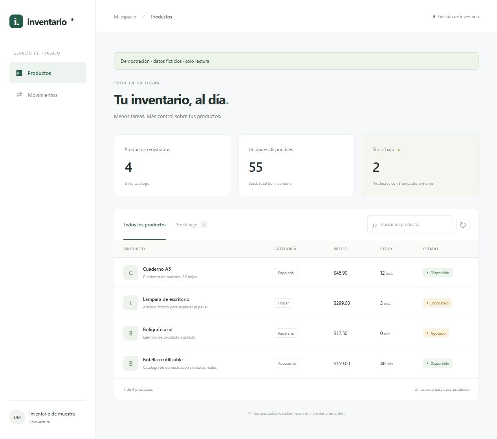
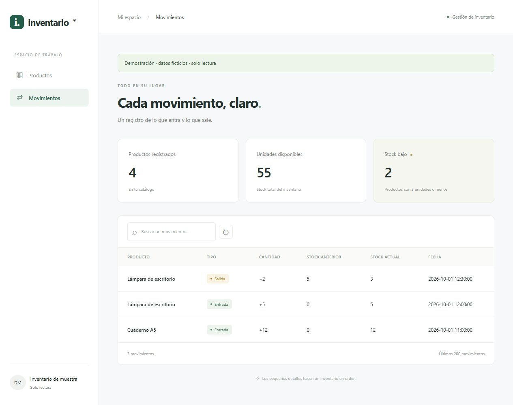

# Inventario web con Python, Flask y MySQL

[](https://github.com/nandillo156-bot/sistema-inventario-python/actions/workflows/tests.yml)

Aplicación para un pequeño negocio que necesita consultar su catálogo, detectar productos con pocas existencias y saber qué entradas o salidas cambiaron el stock. Por ejemplo, al retirar cuatro unidades de un producto se guardan tanto las existencias resultantes como el movimiento que explica el cambio.

El frontend de HTML, CSS y JavaScript consume una API Flask con MySQL, inicio de sesión y permisos por rol. El proyecto incluye pruebas automatizadas y una demostración de solo lectura con datos ficticios. También conserva su versión inicial de consola.

**Autor:** Fernando Ramos Alba · Estudiante de Ingeniería en Desarrollo de Software · [GitHub](https://github.com/nandillo156-bot)

## Vista del proyecto

Capturas del modo de demostración, con datos ficticios.

**Catálogo y existencias**



**Historial de movimientos**



El [registro de verificación](docs/verificacion.md) incluye el flujo privado con MySQL y las capturas de su revisión en escritorio y móvil.

## Qué puedes hacer

- Registrar, consultar y editar productos; eliminarlos cuando no tienen historial.
- Buscar productos y filtrar los que tienen 5 unidades o menos.
- Registrar entradas y salidas sin permitir existencias negativas.
- Consultar los últimos 200 movimientos desde el panel web.
- Ver el número de productos, las unidades disponibles y las alertas de stock bajo.
- Iniciar sesión con una cuenta de consulta, operador o administrador.
- Explorar una demostración con datos ficticios, sin configurar MySQL.

## Decisiones técnicas

- **Separar rutas y reglas.** Flask recibe HTTP y devuelve JSON; `servicio_inventario.py` valida los datos y ejecuta SQL. Las reglas pueden probarse sin depender de una ruta y los dos comandos de inicio web utilizan la misma aplicación.
- **Guardar stock e historial juntos.** El servicio lee el producto con `SELECT ... FOR UPDATE` y confirma el cambio de existencias y su movimiento en una sola transacción. Si falla, solicita `rollback()`. Editar el catálogo conserva el stock: los cambios de existencias se registran mediante movimientos.
- **Comprobar el acceso en el backend.** Los roles se verifican antes de ejecutar una operación; ocultar botones solo adapta la interfaz. El modo demo consulta únicamente `demo.py`, sin conectar MySQL, y rechaza las escrituras.

## Tecnologías

Python 3.14, Flask, MySQL 8.0.16 o posterior, HTML, CSS, JavaScript, mysql-connector-python, python-dotenv, Pipenv y pytest. Gunicorn actúa como servidor WSGI en la comprobación de CI sobre Linux; el arranque local en Windows sigue siendo `python app.py`. Las versiones de las dependencias están fijadas en `Pipfile.lock`.

## Probar la demostración sin MySQL

Instala las dependencias siguiendo el paso 1 y ejecuta en PowerShell:

```powershell
$env:APP_MODE = 'demo'
pipenv run python app.py
```

En macOS o Linux:

```bash
APP_MODE=demo pipenv run python app.py
```

Abre [http://127.0.0.1:5000](http://127.0.0.1:5000). El panel muestra **«Demostración · datos ficticios · solo lectura»**. Los productos y movimientos proceden únicamente de `demo.py`: este modo no consulta la base de datos ni necesita una cuenta. Las escrituras, el login y el logout se rechazan con 403, y `/login` redirige al panel.

Para usar tu inventario privado, cambia `APP_MODE` a `private` y reinicia el servidor. En PowerShell la variable permanece en esa terminal hasta que la cambies o cierres.

## Ejecutar en tu equipo: modo privado

### 1. Clonar e instalar

Necesitas Python 3.14, Pipenv y un servidor MySQL en ejecución. El cliente `mysql` debe estar disponible para importar el esquema; también puedes ejecutar el archivo SQL desde MySQL Workbench.

```bash
git clone https://github.com/nandillo156-bot/sistema-inventario-python.git
cd sistema-inventario-python
python -m pip install pipenv
pipenv sync --dev
```

### 2. Crear la base de datos

Desde la raíz del proyecto abre el cliente MySQL. `-p` solicita tu contraseña sin escribirla en el comando:

```bash
mysql -h 127.0.0.1 -P 3306 -u tu_usuario -p
```

Dentro del cliente, ejecuta:

```sql
SOURCE database/inventario.sql;
SHOW TABLES FROM inventario;
```

El usuario necesita permisos para crear la base y las tablas. El script crea `inventario` y las tablas `productos`, `movimientos` y `usuarios` si no existen, sin borrar datos. **No actualiza la estructura de tablas antiguas**: si ya tienes una base, revisa su estructura antes de reutilizarla. Para añadir únicamente el acceso a una instalación existente, utiliza el comando del paso 4.

Se requiere MySQL 8.0.16 o posterior porque versiones anteriores no aplican las restricciones `CHECK`. Consulta la [documentación de MySQL](https://dev.mysql.com/doc/refman/8.0/en/create-table-check-constraints.html).

### 3. Configurar `.env`

Si ya tienes un archivo `.env`, edítalo conservando tus credenciales. Para crear uno nuevo, copia `.env.example`. En PowerShell:

```powershell
Copy-Item .env.example .env
```

En macOS o Linux:

```bash
cp .env.example .env
```

Configura `DB_HOST`, `DB_PORT`, `DB_USER`, `DB_PASSWORD` y `DB_DATABASE` con los datos de tu instancia. El esquema inicial usa `inventario` como nombre de base. `.env` está excluido de Git.

Las opciones del servidor web son:

| Variable | Comportamiento |
| --- | --- |
| `APP_MODE` | `private` por defecto; `demo` permite consultar solo los datos ficticios. |
| `APP_ENV` | `development` por defecto; `production` exige una clave estable y activa cookies `Secure`. |
| `FLASK_SECRET_KEY` | Firma las sesiones. En desarrollo puede omitirse y se genera una clave temporal; en producción debe ser persistente y tener al menos 32 caracteres. |
| `TRUSTED_HOSTS` | Hosts aceptados, separados por comas. Por defecto admite `localhost`, `127.0.0.1` y `::1`. |

Una clave temporal invalida las sesiones al reiniciar el servidor. Las cookies `Secure` necesitan HTTPS; configurar `APP_ENV=production` no configura por sí mismo el servidor ni el despliegue.

### 4. Preparar el acceso y crear la primera cuenta

Con `APP_MODE=private`, ejecuta:

```bash
pipenv run flask --app app inicializar-acceso
pipenv run flask --app app crear-usuario --nombre fernando --rol administrador
```

`inicializar-acceso` crea únicamente la tabla `usuarios` en la base configurada y conserva el catálogo y los movimientos existentes. Puedes utilizarlo al actualizar una instalación anterior, sin volver a importar todo el esquema.

`crear-usuario` pide una contraseña oculta y su confirmación. Debe tener entre 12 y 128 caracteres. **No existe una contraseña ni una cuenta predeterminada.** La base guarda un hash `scrypt`; la contraseña no se pasa como argumento del comando.

Para otras cuentas utiliza `--rol consulta` o `--rol operador`. La [guía de acceso y permisos](docs/acceso-y-permisos.md) explica la configuración y las limitaciones de esta etapa.

### 5. Abrir el panel Flask

```bash
pipenv run python app.py
```

Abre [http://127.0.0.1:5000](http://127.0.0.1:5000). El panel comprueba la sesión y te dirige a `/login` si no has iniciado sesión. La aplicación se ejecuta en la interfaz local y con debug desactivado.

`web_app.py` es una entrada compatible al mismo servidor Flask:

```bash
pipenv run python web_app.py
pipenv run python web_app.py --port 8001
```

El primer comando usa [http://127.0.0.1:8000](http://127.0.0.1:8000); el segundo usa [http://127.0.0.1:8001](http://127.0.0.1:8001). Ejecuta uno de los comandos para iniciar el panel.

La consola sigue disponible con `pipenv run python main.py`; todavía usa las operaciones de `inventario.py` y su migración al servicio compartido está pendiente. Los permisos de esta etapa se aplican al panel y a su API; la consola anterior trabaja directamente con MySQL.

## Sesión y permisos

| Rol | Consultar productos e historial | Registrar movimientos | Crear, editar y eliminar productos |
| --- | --- | --- | --- |
| `consulta` | Sí | No | No |
| `operador` | Sí | Sí | No |
| `administrador` | Sí | Sí | Sí |

El panel oculta las acciones que no corresponden a la cuenta y el backend comprueba los permisos en cada petición. Cambiar el HTML del navegador no concede acceso.

La sesión tiene una duración configurada de 30 minutos y utiliza una cookie `HttpOnly` con `SameSite=Lax`. El backend consulta de nuevo el estado activo y el rol de la cuenta en MySQL al atender las peticiones de API con sesión. JavaScript conserva el token CSRF en memoria, sin guardarlo en `localStorage`, y todas las escrituras de API, incluidos login y logout, requieren `X-CSRF-Token`.

El acceso admite hasta 5 intentos por IP en 300 segundos. Este límite vive en memoria de cada proceso y se pierde al reiniciarlo; un despliegue con varios procesos requiere un control compartido, por ejemplo en el proxy o en Redis.

## Cómo se organiza el código

```text
sistema-inventario-python/
├── .github/workflows/tests.yml  # Pruebas automáticas en GitHub
├── database/inventario.sql      # Esquema inicial de MySQL
├── database/migrations/        # Cambios de esquema, incluido el acceso con usuarios
├── docs/guia-codigo.md          # Recorrido explicado y ejercicios
├── docs/acceso-y-permisos.md    # Cuentas, sesiones, permisos y modos de ejecución
├── docs/verificacion.md        # Resultados locales y evidencia de navegador
├── tests/                      # Modelo, servicio y API con conexiones simuladas
├── web/                        # HTML, CSS y JavaScript del panel
├── templates/                  # Referencia de los formularios anteriores
├── app.py                      # Factory Flask, rutas HTTP y respuestas JSON
├── configuracion_web.py        # Modos privado/demo y desarrollo/producción
├── usuarios.py                 # Cuentas, hashes y comprobación de credenciales
├── seguridad.py                # Permisos por rol y límite de intentos de acceso
├── demo.py                     # Catálogo ficticio de solo lectura, sin MySQL
├── web_app.py                  # Entrada compatible al mismo servidor Flask
├── servicio_inventario.py      # Validación y operaciones SQL del panel
├── main.py                     # Menú de consola
├── inventario.py               # Operaciones de consola pendientes de migrar
├── producto.py                 # Modelo y validación del producto
├── movimiento.py               # Representación de un movimiento de consola
├── validaciones.py             # Reglas de precio/stock y lectura de consola
├── conexion.py                 # Conexión a MySQL desde variables de entorno
├── .env.example                # Configuración de ejemplo sin datos personales
├── Pipfile
└── Pipfile.lock
```

`create_app(config=None)` construye la aplicación y permite cambiar su configuración en las pruebas. Las rutas de `app.py` reciben HTTP; `servicio_inventario.py` recibe datos de Python, aplica las reglas y consulta MySQL sin conocer las peticiones HTTP. Este patrón está descrito en la [guía oficial de factories de Flask](https://flask.palletsprojects.com/en/stable/patterns/appfactories/).

La [guía del código](docs/guia-codigo.md) explica el recorrido desde un clic hasta MySQL, el acceso por sesión y permisos, la separación entre rutas y reglas y el uso de `with`, `yield` y `finally` para cerrar recursos.

## API del panel

| Método | Ruta | Operación y respuesta correcta | Permiso en modo privado |
| --- | --- | --- | --- |
| GET | `/api/sesion` | Consultar usuario o `null`, modo demo, permisos y token CSRF, 200. | Público. |
| POST | `/api/login` | Comprobar `nombre` y `clave`; devolver estado de sesión y token nuevo, 200. | Público, con CSRF. |
| POST | `/api/logout` | Cerrar la sesión y devolver usuario `null` y token nuevo, 200. | Token CSRF. |
| GET | `/api/productos` | Listar productos, 200. | `consultar`. |
| POST | `/api/productos` | Registrar un producto, 201 con su `id` y cabecera `Location`. | `gestionar_productos`. |
| GET | `/api/productos/{id}` | Consultar un producto, 200. | `consultar`. |
| PUT | `/api/productos/{id}` | Editar datos sin cambiar stock, 200. | `gestionar_productos`. |
| DELETE | `/api/productos/{id}` | Eliminar si no tiene movimientos, 200. | `gestionar_productos`. |
| GET | `/api/movimientos` | Consultar los últimos 200 movimientos, 200. | `consultar`. |
| POST | `/api/productos/{id}/movimientos` | Registrar una entrada o salida, 201 con el nuevo stock. | `mover_stock`. |

En modo privado las rutas de inventario requieren una sesión válida. Para iniciar sesión, primero se consulta `/api/sesion` y después se envía su `csrf_token` en `X-CSRF-Token` al hacer POST a `/api/login`. El panel realiza esta secuencia automáticamente y utiliza el nuevo token que recibe al entrar.

Las escrituras reciben un objeto JSON con `Content-Type: application/json`. Para crear un producto se requieren `nombre`, `descripcion`, `precio`, `stock` y `categoria`. Para editar se requieren los mismos campos salvo `stock`: es opcional y se ignora si se envía. El stock guardado se lee dentro de la transacción. Un movimiento requiere `tipo` (`Entrada` o `Salida`) y `cantidad` entera positiva.

Los errores se devuelven como JSON con la forma `{"error": "mensaje"}`:

| Estado HTTP | Significado |
| --- | --- |
| 400 | Datos o JSON inválidos. |
| 401 | Falta una sesión válida o las credenciales de acceso son incorrectas. |
| 403 | Falta de permisos, token CSRF inválido, origen ajeno o escritura en modo demo. |
| 404 | Producto o ruta inexistente. |
| 405 | Método HTTP no admitido para la ruta. |
| 409 | Nombre duplicado o intento de borrar un producto con historial. |
| 410 | Envío a uno de los formularios anteriores, ya retirados. |
| 413 | Petición de API superior al límite de 65 536 bytes. |
| 415 | El cuerpo enviado no usa `application/json`. |
| 429 | Límite de intentos de acceso alcanzado; `Retry-After` indica la espera. |
| 503 | Error al acceder a MySQL; los detalles internos no se devuelven al navegador. |

`/` y `/productos` sirven el panel de `web/`; `/login` sirve la pantalla de acceso en modo privado. Las visitas GET a `/registrar` y `/editar/{id}` redirigen al panel. Los POST a esas rutas y a `/eliminar/{id}` devuelven 410 sin consultar la base. Los archivos de `templates/` se conservan como referencia y ya no tienen rutas activas que los rendericen.

Flask valida el host contra `TRUSTED_HOSTS`. Las escrituras que incluyen `Origin` deben coincidir con el origen del servidor, además de pasar las comprobaciones de sesión, permisos y CSRF.

## Base de datos y reglas

`productos` guarda el catálogo. `movimientos.producto_id` referencia a un producto y conserva tipo, cantidad, stock anterior, stock actual y fecha automática. `usuarios` guarda nombres únicos, hashes de contraseña, rol y estado activo. El historial de movimientos todavía no identifica al usuario que realizó cada operación.

- El nombre es único sin distinguir mayúsculas y minúsculas; los acentos sí se distinguen.
- Nombre y categoría admiten hasta 255 caracteres; descripción se guarda como `TEXT`.
- MySQL guarda el precio como `DECIMAL(10,2)`. El modelo acepta precios finitos entre `0.01` y `99999999.99` y rechaza booleanos.
- Stock y cantidades se limitan al rango de `INT`: hasta `2147483647`. El stock puede ser cero; una cantidad de movimiento debe ser positiva.
- Una clave foránea impide borrar productos con historial, y los `CHECK` verifican cantidades positivas y balances de cada movimiento.

La precisión de precios con más de dos decimales todavía requiere una política explícita de redondeo y el uso de `Decimal` de extremo a extremo.

## Pruebas y validación

```bash
pipenv run python -m pytest -q
```

La suite habitual no requiere MySQL activo. Comprueba el modelo, las validaciones, la consola, el servicio y las respuestas HTTP usando el cliente de pruebas de Flask y conexiones simuladas. Cubre la conservación del stock al editar, movimientos, conflictos, rollback y cierre de recursos. También prueba usuarios, sesión, permisos, CSRF, el límite de intentos y el aislamiento de la demo, además de recorridos de una ruta Flask hasta el servicio con la base simulada.

La ejecución predeterminada omite las pruebas marcadas como `mysql`. Para ejecutar la integración real desde PowerShell:

```powershell
$env:RUN_MYSQL_INTEGRATION = "1"
pipenv run python -m pytest -q -m mysql tests/test_mysql_acceso.py
Remove-Item Env:RUN_MYSQL_INTEGRATION
```

Estas pruebas requieren permisos para crear y eliminar bases de datos. Usan nombres `inventario_test_` con UUID, importan el esquema y eliminan únicamente esas bases temporales. Se verificaron el login real, permisos de consulta, alta de producto, movimiento de stock, logout, desactivación de cuenta y repetición de la migración. Los productos de la base local se conservan.

También se completó manualmente en el navegador el recorrido de acceso, alta, salida de 4 unidades, consulta del historial y cierre de sesión, con MySQL temporal. Se revisó el panel en una ventana móvil de 390 × 844. El [registro de verificación](docs/verificacion.md) distingue esta revisión de las pruebas automáticas y muestra sus capturas. Queda pendiente automatizar el recorrido y ampliar la cobertura a otros roles y a la concurrencia real.

El [workflow de GitHub Actions](https://github.com/nandillo156-bot/sistema-inventario-python/actions/workflows/tests.yml) está configurado para cada push y pull request con dos trabajos: `tests` ejecuta la suite habitual y comprueba por HTTP la demo con Gunicorn, sin MySQL; `mysql-integration` ejecuta las pruebas reales con un servicio MySQL 8.4 y bases temporales. La insignia del inicio enlaza el estado de las ejecuciones remotas.

## Cómo explicarlo en entrevista

Un producto tiene 10 unidades y, en el modo privado, un operador registra una salida de 4:

1. JavaScript envía `POST /api/productos/{id}/movimientos` con `{"tipo":"Salida","cantidad":4}`, la cookie de sesión y el token CSRF.
2. Flask comprueba la cuenta activa, el permiso `mover_stock` y el token antes de llamar al servicio.
3. El servicio lee las 10 unidades con `FOR UPDATE`, calcula `10 - 4 = 6` y valida que el stock no quede negativo.
4. Un `UPDATE` guarda 6 unidades y un `INSERT` registra el historial de 10 a 6. `commit()` confirma ambos cambios; un fallo antes de confirmar provoca `rollback()`.
5. La API responde 201 con `{"stock":6}` y el panel actualiza sus datos.

Este recorrido conecta frontend, HTTP, permisos, reglas y persistencia. La [guía del código](docs/guia-codigo.md) lo desarrolla paso a paso y propone ejercicios para explicarlo con tus propias palabras.

## Estado y siguientes mejoras

El panel usa Flask y un servicio de inventario común. Los comandos `app.py` y `web_app.py` arrancan la misma aplicación, con login, permisos y una demo aislada de los datos reales. La demo ya puede ejecutarse localmente; su despliegue público por HTTPS está pendiente.

Las siguientes iteraciones son:

1. Migrar la consola al servicio para compartir validación, transacciones y manejo de errores.
2. Ampliar la integración MySQL con concurrencia y más comprobaciones de restricciones.
3. Definir el tratamiento de precios con más de dos decimales y usar `Decimal` de extremo a extremo.
4. Añadir auditoría persistente que relacione las operaciones con su usuario.
5. Implementar restablecimiento de contraseñas e interfaz de gestión de usuarios.
6. Preparar el despliegue HTTPS, la configuración del servidor y el límite de acceso compartido entre procesos.
7. Automatizar los recorridos del navegador, cubrir otros roles y ampliar la revisión de accesibilidad.

La guía explica estas decisiones para poder defenderlas en una entrevista.
