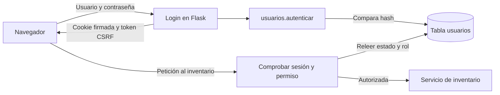

# Acceso, sesiones y permisos

El panel tiene dos formas de uso: `private` para trabajar con cuentas y MySQL, y `demo` para explorar datos ficticios de solo lectura. Esta guía explica cómo preparar el acceso y qué comprueba el código en cada petición.

## 1. Autenticación y autorización

**Autenticación** significa comprobar quién eres: el usuario y la contraseña permiten iniciar sesión. **Autorización** significa comprobar qué puedes hacer: el rol de esa cuenta determina las operaciones permitidas.

| Rol | Consultar productos e historial | Registrar entradas y salidas | Crear, editar o eliminar productos |
| --- | --- | --- | --- |
| `consulta` | Sí | No | No |
| `operador` | Sí | Sí | No |
| `administrador` | Sí | Sí | Sí |

La tabla corresponde a `PERMISOS_POR_ROL` de `seguridad.py`. `app.py` relaciona cada ruta con un permiso. El frontend oculta las acciones que no corresponden al usuario y el servidor vuelve a comprobar el permiso aunque alguien envíe una petición sin usar los botones.



## 2. Preparar las cuentas de la instalación privada

Primero configura la conexión a una base de inventario existente, como explica el [README](../Readme.md). El modo predeterminado es `APP_MODE=private`. Si has usado antes la demo en esa terminal, vuelve a seleccionar `private` antes de administrar cuentas.

Estos comandos se ejecutan desde la raíz del proyecto:

```bash
pipenv run flask --app app inicializar-acceso
pipenv run flask --app app crear-usuario --nombre fernando --rol administrador
```

`inicializar-acceso` ejecuta `database/migrations/001_usuarios.sql` en la base configurada. Crea únicamente la tabla `usuarios` si falta; conserva productos, movimientos y cuentas existentes. No crea la base de datos ni actualiza una tabla `usuarios` anterior con otra estructura. La migración no se aplica automáticamente al arrancar Flask.

`crear-usuario` pide una contraseña oculta y solicita repetirla. No hay cuentas ni contraseñas predeterminadas. Para otras cuentas, cambia el nombre y usa uno de los roles `consulta`, `operador` o `administrador`.

El nombre admite entre 3 y 80 caracteres: letras ASCII, números, `_`, `-` y `.`. Se recortan los espacios de los extremos y no puede repetirse cambiando solo mayúsculas. La contraseña admite entre 12 y 128 caracteres; sus espacios se conservan. No se pasa como argumento del comando ni se imprime.

Después inicia el panel con `pipenv run python app.py` y abre [http://127.0.0.1:5000](http://127.0.0.1:5000). El navegador muestra `/login` cuando necesita identificar al usuario. Las rutas del inventario requieren una cuenta activa en modo privado.

Los dos comandos anteriores modifican la base solo cuando decides ejecutarlos. En modo `demo` se rechazan: la demostración no administra cuentas.

## 3. Qué se guarda de la contraseña

La tabla `usuarios` contiene `id`, `nombre`, `password_hash`, `rol`, `activo` y `creado_en`. `password_hash` guarda el resultado de scrypt, calculado por `generate_password_hash()` de Werkzeug, con una sal aleatoria. La sal permite que dos cuentas con la misma contraseña tengan hashes distintos.

Un **hash** sirve para comprobar una contraseña, no para recuperar su texto original. `check_password_hash()` compara la clave recibida con lo guardado. Es el flujo descrito por los [helpers de seguridad de Werkzeug](https://werkzeug.palletsprojects.com/en/stable/utils/#werkzeug.security.generate_password_hash).

`usuarios.autenticar()` devuelve únicamente `id`, `nombre` y `rol`, o `None` si rechaza las credenciales. Para una cuenta ausente o inactiva también comprueba un hash ficticio, evitando saltarse el trabajo de esa comparación. La respuesta al navegador es el mismo mensaje de credenciales incorrectas; no revela si el nombre existe.

## 4. Cómo se conserva la sesión

Tras un login correcto, Flask envía la cookie `inventario_sesion`. Contiene el ID del usuario, el token CSRF y metadatos de sesión; no contiene contraseña, hash ni rol.

La cookie está **firmada**, no cifrada: su firma permite detectar una modificación, pero no convierte su contenido en secreto. Por eso la clave del servidor debe mantenerse privada y esos datos sensibles no se guardan en la cookie. La [guía de sesiones de Flask](https://flask.palletsprojects.com/en/stable/quickstart/#sessions) explica esta diferencia.

En este proyecto la sesión autenticada dura 30 minutos y no se renueva automáticamente con cada petición. La cookie usa `HttpOnly` y `SameSite=Lax`; en producción también usa `Secure`. Estas opciones limitan su acceso desde JavaScript y su envío en determinados contextos, como explica la [documentación de seguridad de Flask](https://flask.palletsprojects.com/en/stable/web-security/#set-cookie-options).

En cada petición protegida, `cargar_usuario()` consulta `usuarios.obtener_usuario()` para releer `activo` y `rol` desde MySQL. El navegador no decide el rol. Una cuenta desactivada o con un rol inválido deja de poder acceder en la siguiente comprobación.

## 5. CSRF y las rutas de acceso

El navegador adjunta cookies automáticamente. **CSRF** es el intento de provocar una acción aprovechando esa sesión desde otra página. Aquí cada escritura necesita también el encabezado `X-CSRF-Token` con el valor esperado por el servidor. Este control se añade en la aplicación; Flask no lo genera automáticamente. Consulta la [explicación de CSRF de Flask](https://flask.palletsprojects.com/en/stable/web-security/#cross-site-request-forgery-csrf).

El flujo de `web/login.js` y `web/app.js` es:

1. `GET /api/sesion` devuelve `usuario`, `modo_demo`, `csrf_token` y `permisos`. Antes del login, `usuario` es `null` y no hay permisos privados.
2. `POST /api/login` envía un objeto JSON con `nombre` y `clave`, junto con el token CSRF. Si las credenciales son correctas, devuelve el estado de sesión actualizado.
3. Las escrituras del inventario envían el token actual en `X-CSRF-Token`. El servidor comprueba también sesión y permiso.
4. `POST /api/logout` necesita el token actual, limpia la identidad y devuelve el nuevo estado sin usuario.

El token cambia al iniciar y cerrar sesión. El frontend conserva el valor recibido para las siguientes peticiones. También se rechaza una escritura si incluye un encabezado `Origin` distinto del origen del servidor.

| Estado | Qué significa en el control de acceso |
| --- | --- |
| 401 | Falta una sesión válida para el inventario o las credenciales del login son incorrectas. |
| 403 | La cuenta no tiene permiso, falla CSRF/Origin o se intenta escribir en la demo. |
| 429 | Se ha alcanzado el límite temporal de intentos de login. |
| 503 | No se pudo completar el acceso necesario a MySQL. |

El límite actual admite hasta 5 intentos de login por IP en una ventana de 300 segundos; cuentan también las solicitudes con credenciales correctas. Un bloqueo devuelve `Retry-After` con los segundos de espera. El contador vive en memoria y pertenece a un solo proceso: antes de usar varios trabajadores hace falta un límite compartido. También debe definirse correctamente qué proxy puede informar de la IP del cliente.

## 6. Demo y configuración del entorno

`APP_MODE` y `APP_ENV` resuelven decisiones diferentes:

| Variable | Valor | Comportamiento |
| --- | --- | --- |
| `APP_MODE` | `private`, predeterminado | Usa cuentas y MySQL; exige login en la API de inventario. |
| `APP_MODE` | `demo` | Consulta datos ficticios de `demo.py` sin conectar a MySQL. Las escrituras de las rutas de inventario y acceso devuelven 403. |
| `APP_ENV` | `development`, predeterminado | Permite HTTP local y genera una clave de sesión temporal si no se configura una. Reiniciar con una clave nueva invalida las sesiones anteriores. |
| `APP_ENV` | `production` | Exige `FLASK_SECRET_KEY` estable de al menos 32 caracteres, desactiva la posibilidad de debug y exige cookies `Secure`. |

Para explorar la demo desde PowerShell:

```powershell
$env:APP_MODE = "demo"
pipenv run python app.py
```

Al terminar, puedes volver al modo privado en esa terminal con `$env:APP_MODE = "private"`. El modo demo no crea usuarios ni copia datos del inventario real.

`TRUSTED_HOSTS` recibe dominios separados por comas, sin el esquema `https://`. Su valor local predeterminado admite `localhost`, `127.0.0.1` y `[::1]`. En un despliegue debe configurarse el dominio que realmente sirve la aplicación. `FLASK_SECRET_KEY` debe ser aleatoria, privada y compartida por los procesos de la misma aplicación; no debe publicarse en GitHub.

Seleccionar `production` no instala un servidor WSGI ni configura HTTPS. El despliegue, el proxy y el límite compartido de intentos siguen necesitando su propia preparación. `python app.py` conserva el arranque local de desarrollo.

## 7. Ejercicio: distinguir 401 de 403

Hazlo en una instalación local privada con una cuenta de rol `consulta`:

1. En una ventana privada sin login, visita `/api/productos`. En la pestaña Red del navegador verás 401: falta una sesión válida.
2. Entra con la cuenta de consulta. La lectura de `/api/productos` debe responder 200.
3. Desde la consola del navegador del mismo panel, prueba esta solicitud vacía. Con una cuenta de consulta será rechazada antes de escribir en MySQL:

```javascript
const estado = await fetch('/api/sesion').then(r => r.json());
const respuesta = await fetch('/api/productos', {
  method: 'POST',
  headers: {
    'Content-Type': 'application/json',
    'X-CSRF-Token': estado.csrf_token,
  },
  body: JSON.stringify({}),
});
console.log(respuesta.status); // 403
```

La cuenta está identificada, pero su rol no permite crear productos. En este caso 403 expresa falta de permiso. Si omitieras el token en una operación permitida para tu rol, también recibirías 403, por la comprobación de CSRF.

Explica después qué función de `app.py` comprueba la identidad, dónde se define el permiso y por qué ocultar un botón no sería suficiente.

## 8. Alcance de esta etapa

La autenticación, los roles y CSRF protegen la API web del modo privado. La creación de cuentas se administra mediante los comandos locales; todavía no hay una pantalla de gestión de usuarios.

Quedan pendientes la recuperación y cambio de contraseñas, una auditoría persistente de acciones e intentos de acceso, la protección de la consola y su migración al servicio común. La integración optativa `tests/test_mysql_acceso.py` ya comprueba cuentas, login, permisos y movimientos en bases MySQL temporales; faltan concurrencia, más recorridos de navegador y el despliegue. Los permisos web no se aplican automáticamente a `main.py` ni sustituyen los permisos del usuario de MySQL.

Cerrar sesión elimina la cookie de este navegador. Como la sesión está firmada en la propia cookie, una copia anterior conservada fuera del navegador seguiría siendo válida hasta su caducidad de 30 minutos, salvo que se desactive la cuenta o cambie la clave de firma. La revocación individual inmediata en el servidor queda pendiente para una etapa posterior.

Esta etapa permite desarrollar y comprobar el acceso de la aplicación; no declara completada su preparación para producción.
