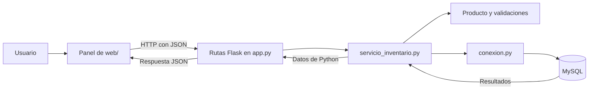

# Aprende el proyecto paso a paso

La meta es que puedas construir, modificar y explicar una aplicación web completa. Esta guía describe el panel Flask que existe hoy y distingue sus mejoras terminadas del trabajo pendiente.

## 1. Del navegador a la base de datos

**Frontend:** es lo que ves y usas en el navegador. `web/index.html` define botones, tablas y formularios; `web/style.css` decide cómo se ven; `web/app.js` responde a los clics y solicita datos al servidor.

**Rutas Flask:** `app.py` recibe las peticiones HTTP, lee JSON y decide qué función del servicio llamar. Después convierte el resultado en una respuesta HTTP.

**Servicio de inventario:** `servicio_inventario.py` valida los datos y ejecuta las operaciones SQL. Recibe y devuelve objetos de Python; puede utilizarse sin un navegador ni Flask.

**Base de datos:** MySQL conserva los productos y los movimientos aunque cierres el navegador o detengas Python. `conexion.py` abre la conexión y `database/inventario.sql` define las tablas y sus restricciones.



Una **petición HTTP** es un mensaje que el navegador envía al servidor. **JSON** es el formato de texto que ambos usan para intercambiar datos. Por ejemplo: `{"tipo": "Salida", "cantidad": 4}`. Las credenciales de MySQL permanecen en la configuración del backend.

## 2. Cómo arranca Flask

Ejecuta `pipenv run python app.py` y abre `http://127.0.0.1:5000`. `app.py` construye la aplicación con `create_app()` y la inicia en la interfaz local, con debug desactivado.

`create_app(config=None)` es una **factory**: una función que crea y configura una aplicación. Registra las rutas, las comprobaciones de entrada y los manejadores de errores, y finalmente devuelve `app`. En las pruebas se puede construir otra instancia con configuración propia:

```python
from app import create_app

aplicacion = create_app({"TESTING": True})
cliente = aplicacion.test_client()
respuesta = cliente.get("/")
assert respuesta.status_code == 200
```

El cliente de pruebas llama a Flask sin abrir un navegador. Este patrón permite crear instancias con configuraciones distintas, como explica la [documentación oficial de factories de Flask](https://flask.palletsprojects.com/en/stable/patterns/appfactories/).

`pipenv run python web_app.py` sigue funcionando en el puerto 8000; `--port 8001` cambia ese puerto. Es una entrada compatible que importa la misma aplicación Flask. La consola se inicia con `main.py` y todavía tiene sus operaciones propias en `inventario.py`.

## 3. Qué pasa al abrir el panel

1. La ruta `/` de Flask devuelve `web/index.html`.
2. El navegador solicita `/style.css` y `/app.js`, que también sirve Flask.
3. JavaScript ejecuta `load()` en `web/app.js`.
4. `load()` llama a `api('/api/productos')` y `api('/api/movimientos')`; `api()` utiliza `fetch()` para enviar las peticiones.
5. Flask busca la ruta que corresponde a cada método y dirección.
6. La ruta llama a `servicio_inventario.listar_productos()` o `listar_movimientos()`.
7. El servicio consulta MySQL y devuelve una lista de diccionarios. Flask la convierte a JSON.
8. JavaScript recibe los datos y `render()` construye las filas de la tabla.

Los formularios anteriores de `templates/` ya no se renderizan. Una visita GET a `/registrar` o `/editar/{id}` redirige al panel. Un POST a esas rutas o a `/eliminar/{id}` recibe 410 sin usar la base. Así, el panel comparte una sola forma de modificar productos y existencias.

## 4. Una ruta y una regla tienen responsabilidades distintas

Este fragmento está dentro de `create_app()` en `app.py`; `inventario` es el alias de `servicio_inventario`:

```python
@app.put("/api/productos/<int:producto_id>")
def actualizar_producto(producto_id):
    return jsonify(
        inventario.actualizar_producto(producto_id, datos_json())
    )
```

El decorador `@app.put(...)` registra la ruta. `<int:producto_id>` convierte el segmento de la dirección en un entero. `datos_json()` comprueba que el cuerpo sea un objeto JSON y `jsonify()` convierte el resultado de Python en una respuesta JSON.

La ruta se ocupa del protocolo HTTP. La regla «editar un producto no cambia su stock» vive en el servicio: este lee las existencias guardadas con `SELECT ... FOR UPDATE`, valida los demás campos y ejecuta un `UPDATE` que no incluye stock. No exige el campo `stock` y lo ignora si llega en los datos.

El servicio ofrece ocho funciones públicas:

| Función | Responsabilidad |
| --- | --- |
| `producto_validado(datos)` | Construir y validar un `Producto` para un alta. |
| `listar_productos()` | Consultar el catálogo, con ID descendente. |
| `listar_movimientos()` | Consultar los últimos 200 movimientos, con ID descendente. |
| `obtener_producto(producto_id)` | Consultar un producto o indicar que no existe. |
| `registrar_producto(datos)` | Validar y guardar un producto nuevo. |
| `actualizar_producto(producto_id, datos)` | Editar sus datos conservando las existencias guardadas. |
| `eliminar_producto(producto_id)` | Eliminarlo si no tiene historial. |
| `registrar_movimiento(producto_id, datos)` | Cambiar stock y registrar el movimiento juntos. |

Estas funciones no conocen peticiones, códigos HTTP ni `jsonify()`. Eso permite probar las reglas por separado y facilita que la consola las reutilice en la siguiente etapa.

## 5. Cómo funciona `Producto`

Una clase permite agrupar datos y comportamiento. Cada objeto `Producto` representa un producto con sus atributos: `id`, `nombre`, `descripcion`, `precio`, `stock` y `categoria`.

```python
from producto import Producto

teclado = Producto(
    None, "Teclado", "Teclado mecánico", 850.50, 10, "Periféricos"
)
print(teclado.nombre)  # Teclado
print(teclado.stock)   # 10
```

`__init__` se ejecuta al crear el objeto. Primero valida los valores; después los guarda en atributos como `self.nombre`. `self` representa el objeto que estás construyendo. `None` indica que todavía no conocemos el ID: MySQL lo asignará al insertar el producto.

Crear el objeto no lo guarda automáticamente. `registrar_producto()` debe ejecutar un `INSERT` y confirmar la transacción para persistirlo.

`_validar_texto()` exige texto no vacío, recorta espacios de los extremos y limita nombre y categoría a 255 caracteres. `validar_stock()` exige un entero entre 0 y `2147483647`. `validar_precio()` rechaza booleanos, valores no finitos y precios fuera del rango de `0.01` a `99999999.99`.

Un caso que necesita una comprobación explícita es `NaN`:

```python
precio = float("nan")
print(precio <= 0)  # False
```

`NaN` significa «no es un número». La condición `precio <= 0` por sí sola no lo rechaza. También se rechazan booleanos porque `bool` es una subclase de `int` en Python y `True` podría confundirse con `1`.

`producto_validado()` convierte campos numéricos que llegan como texto y construye el modelo. Las conversiones inválidas producen `ValueError`. Los nombres que llegan como `null` o listas se rechazan; no se convierten automáticamente en texto.

## 6. Ejemplo: retirar cuatro unidades

Supongamos que un teclado tiene 10 unidades. En el panel eliges una salida de 4:

1. JavaScript envía `POST /api/productos/1/movimientos` con `{"tipo": "Salida", "cantidad": 4}`.
2. La ruta Flask lee el objeto JSON y llama a `registrar_movimiento(1, datos)`.
3. El servicio comprueba que la cantidad sea un entero positivo dentro del rango admitido y que el tipo sea válido.
4. `SELECT stock ... FOR UPDATE` lee las existencias y bloquea ese producto durante la transacción.
5. Calcula `10 - 4 = 6`. Si el resultado fuera negativo, rechazaría la operación.
6. Un `UPDATE` guarda las 6 unidades y un `INSERT` registra la salida, con stock anterior 10 y actual 6.
7. `commit()` confirma ambos cambios. Si falla una operación antes de confirmar, `rollback()` revierte la transacción.
8. Se cierran los recursos y Flask devuelve 201 con `{"stock": 6}`.

Una **transacción** agrupa cambios que deben completarse juntos. El bloqueo evita que dos solicitudes lean las mismas existencias y sobrescriban los resultados de la otra. Esta protección está implementada en el servicio del panel; la consola todavía debe migrar a ese servicio.

## 7. Por qué usamos `with`, `yield` y `finally`

En el servicio encontrarás este uso:

```python
with _sesion() as (conexion, cursor):
    cursor.execute("SELECT id FROM productos ORDER BY id DESC")
    productos = cursor.fetchall()
```

`_sesion()` tiene el decorador `@contextmanager`. Antes de `yield` abre la conexión y crea un cursor con `dictionary=True`, para que una fila se lea como `fila["stock"]` en lugar de depender de posiciones numéricas.

`yield conexion, cursor` entrega esos recursos al bloque `with`. Cuando el bloque termina, incluso con un `return`, la ejecución vuelve al gestor de contexto. Si el bloque lanzó un error, el gestor intenta `rollback()` y propaga el error; `finally` cierra el cursor y la conexión. El cierre de la conexión también se intenta si crear o cerrar el cursor falla.

Un **cursor** ejecuta consultas y lee resultados. La **conexión** mantiene la comunicación con MySQL. Ambos recursos deben cerrarse al terminar.

Las funciones que escriben llaman a `commit()` de forma explícita. El gestor de contexto no confirma automáticamente una lectura ni un bloque incompleto. También transforma los errores MySQL 1062 y 1451 en `ConflictoInventario`; otros errores de base de datos se propagan para que la ruta los trate como fallos del acceso a MySQL.

## 8. Consultas SQL y respuestas HTTP

```python
cursor.execute(
    "SELECT id FROM productos WHERE nombre = %s",
    (nombre,),
)
```

`%s` es un marcador para un valor. El conector recibe la consulta y los parámetros por separado. `(nombre,)` es una tupla de un solo elemento; la coma forma parte de su sintaxis.

- `SELECT` consulta registros.
- `INSERT` agrega un registro.
- `UPDATE` cambia un registro.
- `DELETE` elimina un registro.
- `WHERE` limita los registros afectados.

La base también protege los datos: la clave única impide repetir nombres y la clave foránea con `RESTRICT` impide borrar un producto con historial. Los `CHECK` verifican stock no negativo, cantidades positivas y el balance de cada movimiento.

El script inicial usa `IF NOT EXISTS`. Puedes volver a ejecutarlo para crear objetos faltantes, pero no modifica columnas de tablas que ya existían. Para evolucionar un esquema existente necesitaremos migraciones.

Flask traduce los resultados y errores a HTTP. Un alta devuelve 201 y una cabecera `Location` con la dirección `/api/productos/{id}`, que puede consultarse con GET. Los datos inválidos devuelven 400; `ProductoNoEncontrado`, 404; y `ConflictoInventario`, 409. También hay respuestas JSON para cuerpo demasiado grande (413), formato distinto de JSON (415) y fallos del acceso a MySQL (503).

El servidor acepta hosts locales y comprueba que un `Origin` presente en una escritura coincida con el origen de la petición. No hay autenticación todavía: queda pendiente antes de preparar un despliegue público.

## 9. Qué demuestran las pruebas

```bash
pipenv run python -m pytest -q
```

Una prueba prepara datos, ejecuta una operación y compara el resultado con lo esperado usando `assert`. Las pruebas de modelo verifican reglas de datos; las del servicio usan conexiones simuladas para comprobar consultas, resultados, rollback y cierre de recursos.

Las pruebas HTTP construyen la aplicación con `create_app()` y usan su cliente de pruebas. Comprueban rutas, códigos, cabeceras y JSON. Hay casos que recorren la ruta y el servicio completos con la conexión MySQL sustituida por una simulación.

Por ejemplo, una prueba de salida verifica que 10 menos 4 produzca 6 y que el historial reciba esos valores. Otra simula un fallo al insertar el movimiento y comprueba que se invoque `rollback()`. La edición se prueba también sin campo stock y con un valor de stock que el servicio debe ignorar.

La comprobación local confirmó una conexión a MySQL y las columnas requeridas en las tablas existentes. También se abrió el panel Flask en el navegador y se consultaron datos reales sin realizar escrituras. Quedan pendientes importar el esquema nuevo en una base desechable, comprobar sus restricciones y probar los flujos completos de escritura. Las conexiones simuladas de la suite no sustituyen esas pruebas. GitHub Actions ejecutará la suite al publicar cambios mediante `.github/workflows/tests.yml`.

## 10. Qué está terminado y qué sigue

| Etapa | Estado | Qué aprendes |
| --- | --- | --- |
| Esquema y configuración versionados | Implementados; importación y restricciones del SQL nuevo pendientes. | Entornos y restricciones. |
| Panel con rutas Flask y servicio compartido | Implementado y consultado con MySQL real. | HTTP, factories y responsabilidades. |
| Movimientos transaccionales del panel | Implementados y probados con conexión simulada. | Transacciones, bloqueos y errores. |
| Consola usando el mismo servicio | Pendiente. | Reutilización de reglas y eliminación de duplicación. |
| Integración MySQL y navegador | Conexión y lectura comprobadas; flujos de escritura pendientes. | Pruebas con dependencias reales. |
| Precios, autenticación y despliegue | Pendientes. | Precisión numérica y publicación de una demo. |

MySQL guarda dos decimales, pero el código todavía acepta precios con más decimales y usa `float` en algunas conversiones y en las respuestas JSON. La siguiente mejora debe definir cómo redondearlos y usar `Decimal` de extremo a extremo. La aplicación actual es local; esta etapa no publica un sitio.

## 11. Ejercicios cortos para entenderlo

1. Crea un `Producto` con stock 0. Después prueba con stock -1 y explica por qué lanza un error.
2. Sigue un `fetch` de `web/app.js` hasta la ruta Flask y la función del servicio que ejecuta.
3. Localiza el `UPDATE` de `actualizar_producto()` y explica por qué no contiene el campo stock.
4. En una prueba de salida válida, identifica el stock anterior 10 y el nuevo stock 6.
5. Explica en qué momento se ejecutan `yield` y `finally` cuando un bloque `with _sesion()` termina con `return`.
6. Describe por qué un nombre duplicado devuelve 409 y un ID inexistente devuelve 404.

Para una entrevista, practica esta explicación: «Mi frontend envía peticiones HTTP a Flask. Las rutas delegan en un servicio que valida los datos y usa consultas parametrizadas para MySQL. En el panel, el cambio de stock y su historial se guardan en una misma transacción. Pruebo las reglas y la API con conexiones simuladas, he comprobado consultas con MySQL real y tengo pendientes los flujos de escritura y el despliegue».
