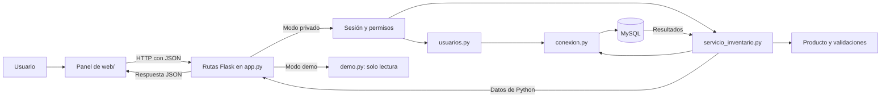

# Aprende el proyecto paso a paso

La meta es que puedas construir, modificar y explicar una aplicación web completa. Esta guía describe el panel Flask que existe hoy y distingue sus mejoras terminadas del trabajo pendiente.

## 1. Del navegador a la base de datos

**Frontend:** es lo que ves y usas en el navegador. `web/index.html` define botones, tablas y formularios; `web/style.css` decide cómo se ven; `web/app.js` comprueba la sesión, responde a los clics y solicita datos al servidor. La pantalla de acceso está en `web/login.html`, con su lógica en `web/login.js` y sus estilos en `web/auth.css`.

**Rutas Flask:** `app.py` recibe las peticiones HTTP, comprueba sesión, permisos y CSRF, lee JSON y decide qué función del servicio llamar. Después convierte el resultado en una respuesta HTTP. `usuarios.py` gestiona las cuentas y sus hashes; `seguridad.py` define los permisos por rol y el límite de intentos de acceso.

**Servicio de inventario:** `servicio_inventario.py` valida los datos y ejecuta las operaciones SQL. Recibe y devuelve objetos de Python; puede utilizarse sin un navegador ni Flask.

**Base de datos:** MySQL conserva los productos y los movimientos aunque cierres el navegador o detengas Python. `conexion.py` abre la conexión y `database/inventario.sql` define las tablas y sus restricciones.

**Demostración:** con `APP_MODE=demo`, las consultas usan únicamente los datos ficticios de `demo.py`. No se abre una conexión a MySQL y el backend rechaza las escrituras.



Una **petición HTTP** es un mensaje que el navegador envía al servidor. **JSON** es el formato de texto que ambos usan para intercambiar datos. Por ejemplo: `{"tipo": "Salida", "cantidad": 4}`. Las credenciales de MySQL permanecen en la configuración del backend.

## 2. Cómo arranca Flask

Ejecuta `pipenv run python app.py` y abre `http://127.0.0.1:5000`. `app.py` construye la aplicación con `create_app()` y la inicia en la interfaz local, con debug desactivado.

`create_app(config=None)` es una **factory**: una función que crea y configura una aplicación. Registra las rutas, las comprobaciones de entrada y los manejadores de errores, y finalmente devuelve `app`. En las pruebas se puede construir otra instancia con configuración propia:

```python
from app import create_app

aplicacion = create_app({"TESTING": True})
cliente = aplicacion.test_client()
respuesta = cliente.get("/")
assert respuesta.status_code == 200
```

El cliente de pruebas llama a Flask sin abrir un navegador. Este patrón permite crear instancias con configuraciones distintas, como explica la [documentación oficial de factories de Flask](https://flask.palletsprojects.com/en/stable/patterns/appfactories/).

`pipenv run python web_app.py` sigue funcionando en el puerto 8000; `--port 8001` cambia ese puerto. Es una entrada compatible que importa la misma aplicación Flask. La consola se inicia con `main.py` y todavía tiene sus operaciones propias en `inventario.py`.

`configuracion_web.py` separa dos decisiones: `APP_MODE` elige `private` o `demo`, y `APP_ENV` elige `development` o `production`. Los valores por defecto son `private` y `development`. En producción se exige una `FLASK_SECRET_KEY` persistente de al menos 32 caracteres y se activa `Secure` en la cookie; para utilizarla necesitas HTTPS. `TRUSTED_HOSTS` permite configurar los dominios aceptados. Estos ajustes todavía necesitan un despliegue y una configuración de servidor adecuados.

En modo privado primero debes preparar el acceso. Para una instalación existente:

```bash
pipenv run flask --app app inicializar-acceso
pipenv run flask --app app crear-usuario --nombre fernando --rol administrador
```

El primer comando crea solo la tabla `usuarios`, conservando productos y movimientos. El segundo pide y confirma una contraseña oculta de entre 12 y 128 caracteres. No hay una cuenta ni una clave predeterminada. Consulta los pasos completos en el [README](../Readme.md) y en la [guía de acceso y permisos](acceso-y-permisos.md).

## 3. Qué pasa al abrir el panel

1. La ruta `/` de Flask devuelve `web/index.html`.
2. El navegador solicita `/style.css` y `/app.js`, que también sirve Flask.
3. JavaScript ejecuta `initialize()` en `web/app.js` y consulta `GET /api/sesion` antes de pedir el catálogo.
4. Si el modo es privado y no hay usuario, redirige a `/login`. Si hay sesión o es una demo, muestra la identidad o el aviso de demostración y aplica los permisos a los botones.
5. `load()` llama a `api('/api/productos')` y `api('/api/movimientos')`; `api()` utiliza `fetch()` para enviar las peticiones.
6. Flask busca la ruta y, en modo privado, comprueba que la cuenta esté activa y tenga permiso para consultar.
7. La ruta llama al servicio de inventario en modo privado, o a `demo.py` en modo demo.
8. El servicio consulta MySQL y devuelve diccionarios; la demo devuelve copias de sus datos ficticios. Flask convierte el resultado a JSON.
9. JavaScript recibe los datos y `render()` construye las filas de la tabla.

Los botones de escritura empiezan ocultos en el HTML. Así no aparecen mientras se comprueba la sesión. Una cuenta de consulta tampoco verá acciones nuevas al cambiar entre las pestañas de productos y movimientos.

Los formularios anteriores de `templates/` ya no se renderizan. Una visita GET a `/registrar` o `/editar/{id}` redirige al panel. Un POST a esas rutas o a `/eliminar/{id}` recibe 410 sin usar la base. Así, el panel comparte una sola forma de modificar productos y existencias.

### Identidad, permisos y CSRF

**Autenticar** es comprobar quién entra: `usuarios.autenticar()` busca la cuenta y compara la contraseña con su hash `scrypt`. El backend guarda el ID de usuario en la sesión Flask; la contraseña no se guarda en texto claro ni se devuelve al navegador. Si la cuenta no existe, está inactiva o la clave es incorrecta, la respuesta de acceso es el mismo 401 genérico.

La sesión utiliza una cookie firmada `HttpOnly` con `SameSite=Lax` y una duración configurada de 30 minutos. `HttpOnly` impide que JavaScript lea esa cookie; el navegador la envía con las peticiones al servidor. El backend vuelve a consultar la cuenta para comprobar su estado activo y su rol, en lugar de confiar en un rol conservado en el navegador.

**Autorizar** es decidir qué puede hacer esa cuenta. `seguridad.py` contiene la relación entre los roles y los permisos:

| Rol | Permisos | Acciones del panel |
| --- | --- | --- |
| `consulta` | `consultar` | Ver productos e historial. |
| `operador` | `consultar`, `mover_stock` | Consultar y registrar entradas o salidas. |
| `administrador` | Los anteriores y `gestionar_productos` | También crear, editar y eliminar productos. |

El servidor devuelve los permisos en `/api/sesion`. La función `can()` de `web/app.js` los utiliza para mostrar los controles. La comprobación decisiva está en `app.py`, antes de llamar al servicio: manipular los botones del navegador no evita un 403 del backend.

**CSRF** protege las escrituras frente a peticiones iniciadas desde otro sitio aprovechando una sesión abierta. JavaScript consulta primero `/api/sesion` y conserva su `csrf_token` en memoria. La función `api()` añade la cabecera `X-CSRF-Token` a las escrituras, incluidos login y logout. El backend compara ese valor con el de la sesión y también comprueba `Origin` cuando está presente.

El recorrido del acceso es:

1. `web/login.js` consulta `/api/sesion` para obtener el token inicial.
2. Envía `POST /api/login` con `nombre`, `clave` y la cabecera CSRF.
3. Flask valida la cuenta, crea la sesión de usuario y devuelve un token nuevo.
4. El navegador vuelve al panel, que consulta otra vez el estado de sesión.
5. `POST /api/logout` utiliza el token actual, borra la identidad de la sesión y devuelve otro token para el estado anónimo.

La clave y el token no se guardan en `localStorage`. El formulario bloquea el envío mientras espera la respuesta y muestra los errores con `role="alert"`. Un 401 recibido por el panel redirige a `/login`; un 401 de acceso se muestra como error de credenciales.

El límite permite 5 intentos de acceso por IP en 300 segundos. `IntentosLogin` guarda ese contador en la memoria del proceso y devuelve una espera al alcanzar el límite; Flask responde 429 con `Retry-After`. Reiniciar el proceso pierde los contadores y varios procesos no los comparten. Antes de desplegar necesitas un límite compartido en el proxy o en un servicio como Redis.

### Explorar la demo

En PowerShell puedes iniciarla así:

```powershell
$env:APP_MODE = 'demo'
pipenv run python app.py
```

En una shell de macOS o Linux, usa `APP_MODE=demo pipenv run python app.py`. El panel muestra «Demostración · datos ficticios · solo lectura», permite consultar sin iniciar sesión y no ofrece botones de escritura. Todas las escrituras de API, incluido el acceso y el cierre de sesión, se rechazan con 403; visitar `/login` devuelve al panel. El aislamiento también está en el backend: este modo lee `demo.py` y no consulta ni el catálogo ni las cuentas de MySQL.

## 4. Una ruta y una regla tienen responsabilidades distintas

Este fragmento está dentro de `create_app()` en `app.py`; `inventario` es el alias de `servicio_inventario`:

```python
@app.put("/api/productos/<int:producto_id>")
def actualizar_producto(producto_id):
    return jsonify(
        inventario.actualizar_producto(producto_id, datos_json())
    )
```

El decorador `@app.put(...)` registra la ruta. `<int:producto_id>` convierte el segmento de la dirección en un entero. `datos_json()` comprueba que el cuerpo sea un objeto JSON y `jsonify()` convierte el resultado de Python en una respuesta JSON.

La ruta se ocupa del protocolo HTTP. La regla «editar un producto no cambia su stock» vive en el servicio: este lee las existencias guardadas con `SELECT ... FOR UPDATE`, valida los demás campos y ejecuta un `UPDATE` que no incluye stock. No exige el campo `stock` y lo ignora si llega en los datos.

Antes de ejecutar esa ruta, `comprobar_solicitud()` verifica sesión, permiso `gestionar_productos` y CSRF. Estas reglas de acceso pertenecen a la capa web; la regla de conservar las existencias pertenece al servicio.

El servicio ofrece ocho funciones públicas:

| Función | Responsabilidad |
| --- | --- |
| `producto_validado(datos)` | Construir y validar un `Producto` para un alta. |
| `listar_productos()` | Consultar el catálogo, con ID descendente. |
| `listar_movimientos()` | Consultar los últimos 200 movimientos, con ID descendente. |
| `obtener_producto(producto_id)` | Consultar un producto o indicar que no existe. |
| `registrar_producto(datos)` | Validar y guardar un producto nuevo. |
| `actualizar_producto(producto_id, datos)` | Editar sus datos conservando las existencias guardadas. |
| `eliminar_producto(producto_id)` | Eliminarlo si no tiene historial. |
| `registrar_movimiento(producto_id, datos)` | Cambiar stock y registrar el movimiento juntos. |

Estas funciones no conocen peticiones, códigos HTTP ni `jsonify()`. Eso permite probar las reglas por separado y facilita que la consola las reutilice en la siguiente etapa.

## 5. Cómo funciona `Producto`

Una clase permite agrupar datos y comportamiento. Cada objeto `Producto` representa un producto con sus atributos: `id`, `nombre`, `descripcion`, `precio`, `stock` y `categoria`.

```python
from producto import Producto

teclado = Producto(
    None, "Teclado", "Teclado mecánico", 850.50, 10, "Periféricos"
)
print(teclado.nombre)  # Teclado
print(teclado.stock)   # 10
```

`__init__` se ejecuta al crear el objeto. Primero valida los valores; después los guarda en atributos como `self.nombre`. `self` representa el objeto que estás construyendo. `None` indica que todavía no conocemos el ID: MySQL lo asignará al insertar el producto.

Crear el objeto no lo guarda automáticamente. `registrar_producto()` debe ejecutar un `INSERT` y confirmar la transacción para persistirlo.

`_validar_texto()` exige texto no vacío, recorta espacios de los extremos y limita nombre y categoría a 255 caracteres. `validar_stock()` exige un entero entre 0 y `2147483647`. `validar_precio()` rechaza booleanos, valores no finitos y precios fuera del rango de `0.01` a `99999999.99`.

Un caso que necesita una comprobación explícita es `NaN`:

```python
precio = float("nan")
print(precio <= 0)  # False
```

`NaN` significa «no es un número». La condición `precio <= 0` por sí sola no lo rechaza. También se rechazan booleanos porque `bool` es una subclase de `int` en Python y `True` podría confundirse con `1`.

`producto_validado()` convierte campos numéricos que llegan como texto y construye el modelo. Las conversiones inválidas producen `ValueError`. Los nombres que llegan como `null` o listas se rechazan; no se convierten automáticamente en texto.

## 6. Ejemplo: retirar cuatro unidades

Supongamos que un teclado tiene 10 unidades. En el panel eliges una salida de 4:

1. JavaScript envía `POST /api/productos/1/movimientos` con `{"tipo": "Salida", "cantidad": 4}`, la cookie de sesión y `X-CSRF-Token`.
2. Flask comprueba la cuenta, el permiso `mover_stock` y el token. Después lee el objeto JSON y llama a `registrar_movimiento(1, datos)`.
3. El servicio comprueba que la cantidad sea un entero positivo dentro del rango admitido y que el tipo sea válido.
4. `SELECT stock ... FOR UPDATE` lee las existencias y bloquea ese producto durante la transacción.
5. Calcula `10 - 4 = 6`. Si el resultado fuera negativo, rechazaría la operación.
6. Un `UPDATE` guarda las 6 unidades y un `INSERT` registra la salida, con stock anterior 10 y actual 6.
7. `commit()` confirma ambos cambios. Si falla una operación antes de confirmar, `rollback()` revierte la transacción.
8. Se cierran los recursos y Flask devuelve 201 con `{"stock": 6}`.

Una **transacción** agrupa cambios que deben completarse juntos. El bloqueo evita que dos solicitudes lean las mismas existencias y sobrescriban los resultados de la otra. Esta protección está implementada en el servicio del panel; la consola todavía debe migrar a ese servicio.

## 7. Por qué usamos `with`, `yield` y `finally`

En el servicio encontrarás este uso:

```python
with _sesion() as (conexion, cursor):
    cursor.execute("SELECT id FROM productos ORDER BY id DESC")
    productos = cursor.fetchall()
```

`_sesion()` tiene el decorador `@contextmanager`. Antes de `yield` abre la conexión y crea un cursor con `dictionary=True`, para que una fila se lea como `fila["stock"]` en lugar de depender de posiciones numéricas.

`yield conexion, cursor` entrega esos recursos al bloque `with`. Cuando el bloque termina, incluso con un `return`, la ejecución vuelve al gestor de contexto. Si el bloque lanzó un error, el gestor intenta `rollback()` y propaga el error; `finally` cierra el cursor y la conexión. El cierre de la conexión también se intenta si crear o cerrar el cursor falla.

Un **cursor** ejecuta consultas y lee resultados. La **conexión** mantiene la comunicación con MySQL. Ambos recursos deben cerrarse al terminar.

Las funciones que escriben llaman a `commit()` de forma explícita. El gestor de contexto no confirma automáticamente una lectura ni un bloque incompleto. También transforma los errores MySQL 1062 y 1451 en `ConflictoInventario`; otros errores de base de datos se propagan para que la ruta los trate como fallos del acceso a MySQL.

## 8. Consultas SQL y respuestas HTTP

```python
cursor.execute(
    "SELECT id FROM productos WHERE nombre = %s",
    (nombre,),
)
```

`%s` es un marcador para un valor. El conector recibe la consulta y los parámetros por separado. `(nombre,)` es una tupla de un solo elemento; la coma forma parte de su sintaxis.

- `SELECT` consulta registros.
- `INSERT` agrega un registro.
- `UPDATE` cambia un registro.
- `DELETE` elimina un registro.
- `WHERE` limita los registros afectados.

La base también protege los datos: la clave única impide repetir nombres y la clave foránea con `RESTRICT` impide borrar un producto con historial. Los `CHECK` verifican stock no negativo, cantidades positivas y el balance de cada movimiento.

El script inicial usa `IF NOT EXISTS`. Puedes volver a ejecutarlo para crear objetos faltantes, pero no modifica columnas de tablas que ya existían. Para evolucionar un esquema existente necesitaremos migraciones.

Flask traduce los resultados y errores a HTTP. Un alta devuelve 201 y una cabecera `Location` con la dirección `/api/productos/{id}`, que puede consultarse con GET. Los datos inválidos devuelven 400; `ProductoNoEncontrado`, 404; y `ConflictoInventario`, 409. También hay respuestas JSON para cuerpo demasiado grande (413), formato distinto de JSON (415) y fallos del acceso a MySQL (503).

La API de acceso añade `GET /api/sesion`, `POST /api/login` y `POST /api/logout`. `/api/sesion` es público y devuelve `usuario` o `null`, `modo_demo`, `permisos` y `csrf_token`. Las rutas privadas de inventario requieren login. Un 401 indica sesión ausente o credenciales incorrectas; un 403 puede indicar permiso insuficiente, CSRF inválido, origen ajeno o escritura en demo; un 429 indica que se alcanzó el límite de intentos de acceso.

El servidor valida el host contra `TRUSTED_HOSTS`, que admite hosts locales por defecto. Estas comprobaciones de acceso y la configuración para producción ya existen; el despliegue público HTTPS sigue pendiente.

## 9. Qué demuestran las pruebas

```bash
pipenv run python -m pytest -q
```

Una prueba prepara datos, ejecuta una operación y compara el resultado con lo esperado usando `assert`. Las pruebas de modelo verifican reglas de datos; las del servicio usan conexiones simuladas para comprobar consultas, resultados, rollback y cierre de recursos.

Las pruebas HTTP construyen la aplicación con `create_app()` y usan su cliente de pruebas. Comprueban rutas, códigos, cabeceras y JSON. Hay casos que recorren la ruta y el servicio completos con la conexión MySQL sustituida por una simulación. Las pruebas de acceso cubren los roles, la sesión, CSRF, los hashes de contraseña y el límite de intentos. Las de demo comprueban que no se invoquen conexiones ni operaciones del inventario real.

Por ejemplo, una prueba de salida verifica que 10 menos 4 produzca 6 y que el historial reciba esos valores. Otra simula un fallo al insertar el movimiento y comprueba que se invoque `rollback()`. La edición se prueba también sin campo stock y con un valor de stock que el servicio debe ignorar.

La suite opcional de `tests/test_mysql_acceso.py` ya se ejecutó contra MySQL real. Cada prueba crea una base temporal `inventario_test_<uuid>`, importa el esquema y elimina únicamente esa base al terminar. Se verificaron login, alta y consulta de un producto, salida con historial, logout, permisos de consulta, revocación de la sesión al desactivar una cuenta y repetición de la migración de acceso sin borrar cuentas.

Estas pruebas requieren una conexión MySQL configurada y permisos para crear y eliminar bases de datos. Se omiten por defecto; para ejecutarlas en PowerShell:

```powershell
$env:RUN_MYSQL_INTEGRATION = '1'
pipenv run python -m pytest tests/test_mysql_acceso.py -m mysql -q
Remove-Item Env:RUN_MYSQL_INTEGRATION
```

La eliminación de la variable vuelve a dejar desactivada la integración opcional para las siguientes ejecuciones de esa terminal. Las pruebas operan sobre sus bases temporales, conservando el catálogo configurado originalmente.

El 22 de octubre de 2026 también se completó una revisión manual del navegador con una cuenta temporal de administrador y MySQL real: acceso, alta de «Cuaderno de revisión» con stock 10 y precio 45.90, salida de 4 unidades, stock resultante 6, historial de 10 a 6 y cierre de sesión con vuelta al acceso. En una ventana de 390 × 844 se comprobó que la tabla mantuviera el desplazamiento horizontal dentro de su contenedor. Las bases temporales de esta revisión se eliminaron al terminar. Las capturas y el alcance están en el [registro de verificación](verificacion.md).

Quedan pendientes automatizar ese recorrido del navegador, cubrir visualmente los otros roles, probar la concurrencia con MySQL real y ampliar la comprobación de restricciones. Las conexiones simuladas permiten verificar que el código solicite rollback, pero no demuestran por sí solas que MySQL haya revertido los cambios.

El workflow `.github/workflows/tests.yml` configura dos trabajos en cada push y pull request. `tests` ejecuta la suite habitual y una comprobación HTTP de la demo con Gunicorn, sin MySQL. `mysql-integration` activa las pruebas reales y utiliza un servicio MySQL 8.4. Localmente la integración sigue siendo opcional; el estado remoto se consulta en [GitHub Actions](https://github.com/nandillo156-bot/sistema-inventario-python/actions/workflows/tests.yml). Gunicorn sirve la aplicación WSGI en ese entorno Linux; en Windows el comando local sigue siendo `pipenv run python app.py`.

## 10. Qué está terminado y qué sigue

| Etapa | Estado | Qué aprendes |
| --- | --- | --- |
| Esquema y configuración versionados | Esquema importado en MySQL temporal y migración de acceso repetible comprobada; falta ampliar las pruebas de restricciones. | Entornos y restricciones. |
| Rutas Flask y servicio compartido | Probados con conexiones simuladas y con el cliente Flask contra MySQL real. | HTTP, factories y responsabilidades. |
| Movimientos transaccionales del panel | Salida e historial verificados en MySQL real; errores y rollback comprobados con simulaciones. | Transacciones, bloqueos y errores. |
| Acceso y permisos de consulta, operador y administrador | Implementados en el panel y el backend. | Autenticación, autorización, sesiones, hashes y CSRF. |
| Demo ficticia sin MySQL | Implementada, con consultas públicas y escrituras bloqueadas. | Aislamiento de datos y modos de ejecución. |
| Consola usando el mismo servicio | Pendiente. | Reutilización de reglas y eliminación de duplicación. |
| Integración MySQL y navegador | Integración automática y flujo manual de administrador verificados en bases temporales; faltan automatización del navegador, otros roles y concurrencia real. | Pruebas con dependencias reales. |
| Auditoría persistente, restablecimiento de claves e interfaz de usuarios | Pendientes. | Trazabilidad y administración de cuentas. |
| Precisión de precios y despliegue HTTPS | Pendientes. | Precisión numérica, servidor y límite de acceso compartido. |

MySQL guarda dos decimales, pero el código todavía acepta precios con más decimales y usa `float` en algunas conversiones y en las respuestas JSON. Una siguiente mejora debe definir cómo redondearlos y usar `Decimal` de extremo a extremo. El historial aún no vincula cada operación a una cuenta, no hay recuperación de contraseña y las cuentas se crean por consola, sin una pantalla de administración. La consola de inventario anterior sigue usando su propio acceso a la base. Esta etapa prepara una demo local; no equivale a un despliegue de producción completo.

## 11. Ejercicios cortos para entenderlo

1. Crea un `Producto` con stock 0. Después prueba con stock -1 y explica por qué lanza un error.
2. Sigue un `fetch` de `web/app.js` hasta la ruta Flask y la función del servicio que ejecuta.
3. Localiza el `UPDATE` de `actualizar_producto()` y explica por qué no contiene el campo stock.
4. En una prueba de salida válida, identifica el stock anterior 10 y el nuevo stock 6.
5. Explica en qué momento se ejecutan `yield` y `finally` cuando un bloque `with _sesion()` termina con `return`.
6. Describe por qué un nombre duplicado devuelve 409 y un ID inexistente devuelve 404.
7. Compara `can()` en JavaScript con `comprobar_solicitud()` en Flask: explica por qué ocultar un botón no basta para dar seguridad.
8. Sigue el token CSRF desde `GET /api/sesion` hasta la cabecera enviada al registrar un movimiento.
9. Explica por qué una petición sin sesión devuelve 401 y una cuenta de consulta que intenta escribir recibe 403.
10. Sigue una consulta en modo demo y comprueba por qué no necesita `conexion.py` ni MySQL.

Para una entrevista, practica esta explicación: «Mi frontend consulta la sesión y adapta sus acciones a los permisos. Flask comprueba la cuenta, el rol y CSRF antes de delegar en un servicio con consultas parametrizadas. El cambio de stock y su historial se guardan en una misma transacción. La demo usa datos ficticios sin conectar MySQL. Validé acceso, altas y movimientos contra MySQL real en bases temporales, tanto con pruebas automáticas como mediante un recorrido manual del navegador. Tengo pendientes la concurrencia real, automatizar y ampliar los recorridos del navegador, la auditoría persistente y el despliegue HTTPS».
