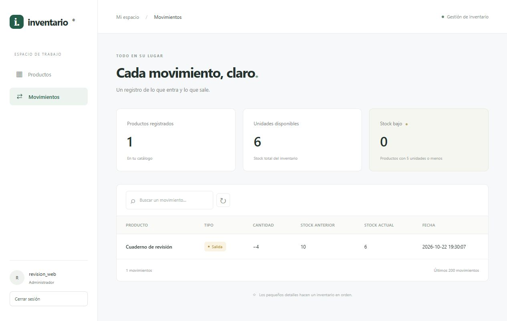
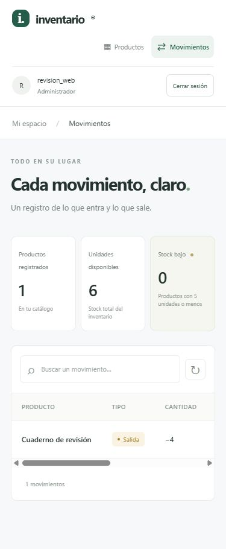

# Registro de verificación

Fecha de la comprobación local: **22 de octubre de 2026**.

Este registro distingue las pruebas automáticas de la revisión manual del navegador. Se utilizaron datos ficticios y bases temporales con UUID; las bases creadas para estas comprobaciones se eliminaron al terminar. El inventario habitual se conservó.

## Pruebas automáticas locales

| Grupo | Resultado local | Alcance |
| --- | --- | --- |
| Suite habitual | 353 aprobadas y 3 omitidas. | Modelo, validación, servicio, API, acceso, permisos, CSRF y demo, con conexiones simuladas. |
| Integración MySQL | 3 aprobadas. | Login, alta y consulta de producto, salida e historial, logout, permisos de consulta, revocación y migración de acceso repetible. |

Las tres omitidas en la ejecución habitual son las pruebas de integración opcionales. Al activarlas, la última ejecución local completa terminó con **356 pruebas aprobadas**. Este resultado corresponde a la ejecución local, no certifica el estado de GitHub Actions.

`tests/test_mysql_acceso.py` crea una base `inventario_test_<uuid>` por prueba, importa el esquema y elimina únicamente esa base al finalizar. Requiere permisos de creación y eliminación de bases. Los comandos para ejecutarlo están en el [README](../Readme.md#pruebas-y-validación).

## Revisión manual con MySQL

Se recorrió la interfaz real del modo privado con una cuenta temporal de administrador:

1. Iniciar sesión y acceder al panel.
2. Crear «Cuaderno de revisión», con precio 45.90 y stock inicial 10.
3. Registrar una salida de 4 unidades.
4. Comprobar que las existencias disponibles fueran 6.
5. Abrir el historial y comprobar cantidad de salida 4, stock anterior 10 y stock actual 6.
6. Revisar el panel en una ventana móvil de 390 × 844: la tabla conserva su desplazamiento horizontal dentro del contenedor.
7. Cerrar sesión y comprobar la redirección a la pantalla de acceso.

Este recorrido utilizó una base temporal con UUID. La cuenta y el producto pertenecían a esa base, que se eliminó después de la revisión.

**Historial después de la salida:**

**Revisión móvil:**

Estas capturas documentan una revisión manual; no constituyen una prueba automatizada del navegador.

## Automatización configurada en GitHub Actions

El workflow [tests.yml](https://github.com/nandillo156-bot/sistema-inventario-python/actions/workflows/tests.yml) configura dos trabajos en cada push y pull request:

| Trabajo | Comprobación configurada |
| --- | --- |
| `tests` | Instalar las versiones del lock, ejecutar la suite habitual y arrancar la demo con Gunicorn en Linux. Consultar su catálogo por HTTP y comprobar que una escritura devuelve 403, sin utilizar MySQL. |
| `mysql-integration` | Levantar un servicio MySQL 8.4 y ejecutar las pruebas de integración con bases temporales. |

El estado remoto corresponde a las ejecuciones enlazadas en ese workflow. Los resultados locales de este documento no deben interpretarse como una ejecución de CI aprobada. La comprobación HTTP de Gunicorn tampoco equivale a una prueba visual ni a un despliegue público.

## Cobertura pendiente

- Automatizar el recorrido del navegador y ampliar sus casos de error.
- Revisar manualmente los roles de consulta y operador; sus permisos ya tienen pruebas de backend.
- Probar operaciones simultáneas contra MySQL real y ampliar las comprobaciones de restricciones.
- Ampliar la revisión de accesibilidad y la cobertura de tamaños de pantalla.

La demo sigue disponible para ejecución local. El despliegue HTTPS y las demás mejoras del producto figuran en el [README](../Readme.md#estado-y-siguientes-mejoras).
